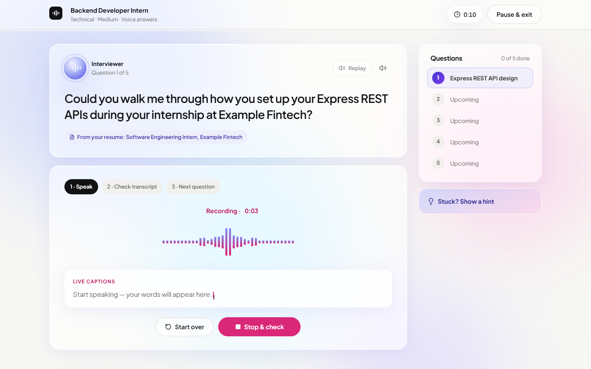
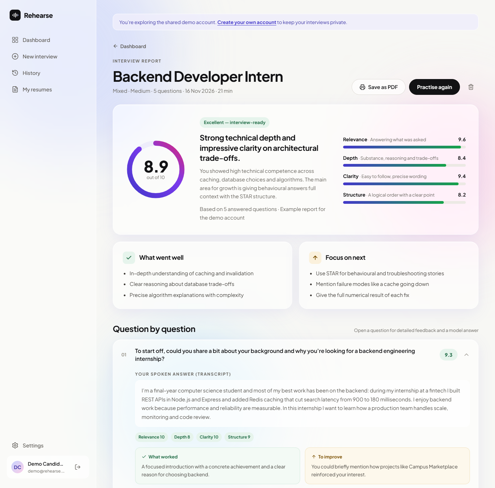
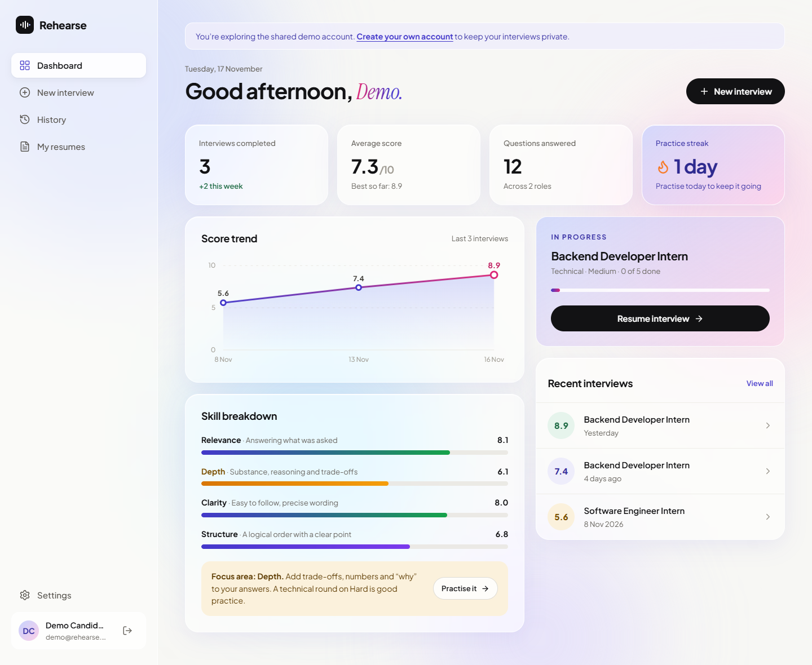
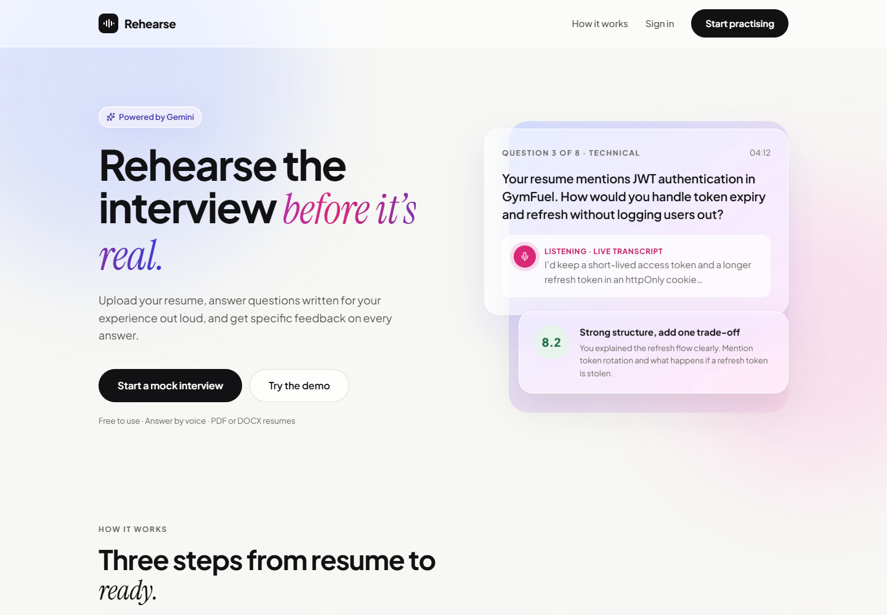

# Rehearse


Practise interviews out loud, with questions written about **your** resume.

You upload your resume and pick a role. Rehearse asks you questions about your own projects and experience, you answer
by speaking into your mic, and you get honest, specific feedback on every answer, including what a stronger answer
would have covered.

> **Live demo:** coming soon (it'll be on Render and Vercel). Until then it runs locally in two commands; see
> [Running it locally](#running-it-locally).



<table>
  <tr>
    <td width="33%"></td>
    <td width="33%"></td>
    <td width="33%"></td>
  </tr>
  <tr>
    <td align="center"><sub>Feedback report</sub></td>
    <td align="center"><sub>Dashboard</sub></td>
    <td align="center"><sub>Landing page</sub></td>
  </tr>
</table>

---

## Why I built it

Most interview prep tools hand you the same generic list: "tell me about yourself", "what's your biggest weakness".
Real interviews aren't like that. The interviewer has your resume open and asks *why you chose MongoDB for that
project* or *what broke when you deployed it*.

I also noticed I could write a decent answer but struggled to *say* it, because typing gives you time to think and
speaking doesn't. So Rehearse makes you answer out loud, then shows you exactly what you said.

## How a session works

1. **Upload your resume** (PDF or DOCX). Rehearse pulls out the text, your skills and your projects.
2. **Set up the interview:** the role, and optionally the company and job description. Choose technical, behavioural,
   HR or mixed questions, easy, medium or hard, and 5, 8 or 10 questions.
3. **Gemini writes the questions**, each tied to something on your resume, plus the points a strong answer would hit.
4. **Answer out loud.** A quick mic check, then each question is read to you. You record your answer while a live
   waveform and captions show it's picking you up, and you can re-record if you fumble.
5. **Check the transcript.** Each recording is transcribed, and you can fix anything it misheard before saving.
6. **Get the report.** Every answer is scored on four skills (relevance, depth, clarity and structure), with what you
   did well, what to fix and a model answer to compare against.
7. **Track progress.** The dashboard shows your average score, a trend over time, your weakest skill and your practice
   streak. Every past interview is searchable in your history.

There's a one-click **demo account** with three finished interviews already in it, so you can see the full report and
dashboard without recording anything.

## The interesting parts

**Questions that stay on track.** Gemini returns questions against a strict JSON schema, then the server validates them
with Zod: broken or duplicate questions are dropped, and the request retries once if too few survive. Your resume and
any pasted job description are clearly marked as data, so a job description containing "ignore your instructions" can't
hijack the interviewer.

**Voice, end to end.** The browser records with MediaRecorder (WebM/Opus) and draws the waveform with the Web Audio API.
Live captions use the browser's speech recognition while you talk. After you stop, the recording goes to Gemini for an
accurate transcript, which is the one that actually gets graded. Answers are capped at 5 minutes and 10 MB.

**Scores you can trust.** Gemini judges each skill, but the server works out the overall score itself from those
judgements, so the numbers on your report are consistent. Evaluation runs in the background, and the report page shows
progress until it's ready.

**Doesn't fall over when the AI does.** Every Gemini call has a timeout. If the main model is overloaded, it falls back
to a lighter one automatically. Question generation is rate-limited per user to protect the quota. With no API key at
all, it still works, using built-in questions based on your resume, so local development and CI need no key.

**Careful with files.** Resumes are processed in memory and never written to disk. The server checks a file's actual
bytes, not just its extension, so a renamed file can't sneak through. Scanned, image-only PDFs are caught with a clear
message instead of producing an empty interview.

## Tech stack

| | |
|---|---|
| Frontend | React 18, React Router, Vite, lucide icons; MediaRecorder, Web Audio and Web Speech APIs |
| Backend | Node.js, Express 5, Mongoose, Zod, Helmet, rate limiting |
| AI | Google Gemini for question generation, transcription and evaluation |
| Files | Multer (in memory), unpdf for PDFs, mammoth for DOCX |
| Database | MongoDB |
| Testing | Vitest, Supertest, an in-memory MongoDB (66 tests) |
| DevOps | Docker, GitHub Actions, Render and Vercel config |

## Running it locally

You need Node.js 20 or newer. With no `MONGODB_URI` the API uses a throwaway in-memory database, and with no
`GEMINI_API_KEY` it uses built-in questions and sample feedback, so it works straight away.

```bash
cd server && npm install && npm run dev     # API on http://localhost:4000
cd client && npm install && npm run dev     # app on http://localhost:5173
cd server && npm test
```

For real AI questions and feedback, get a free key from [Google AI Studio](https://aistudio.google.com/apikey) and put it
in `server/.env` as `GEMINI_API_KEY` (copy `server/.env.example` to start). Use Chrome or Edge for live captions; the
other browsers still record and transcribe fine.

## Deploying

[DEPLOY.md](DEPLOY.md) covers it step by step: MongoDB Atlas, then the API on Render (Docker), the frontend on Vercel,
and the Gemini key on Render.

## What I'd add next

- Follow-up questions that react to what you just said, like a real interviewer
- Filler-word and speaking-pace feedback ("you said 'basically' 14 times")
- Practising against a specific job posting from a link
- Sharing a report with a mentor

---

Built by [Dhruv Thakur](https://github.com/dhruvthakur1).
